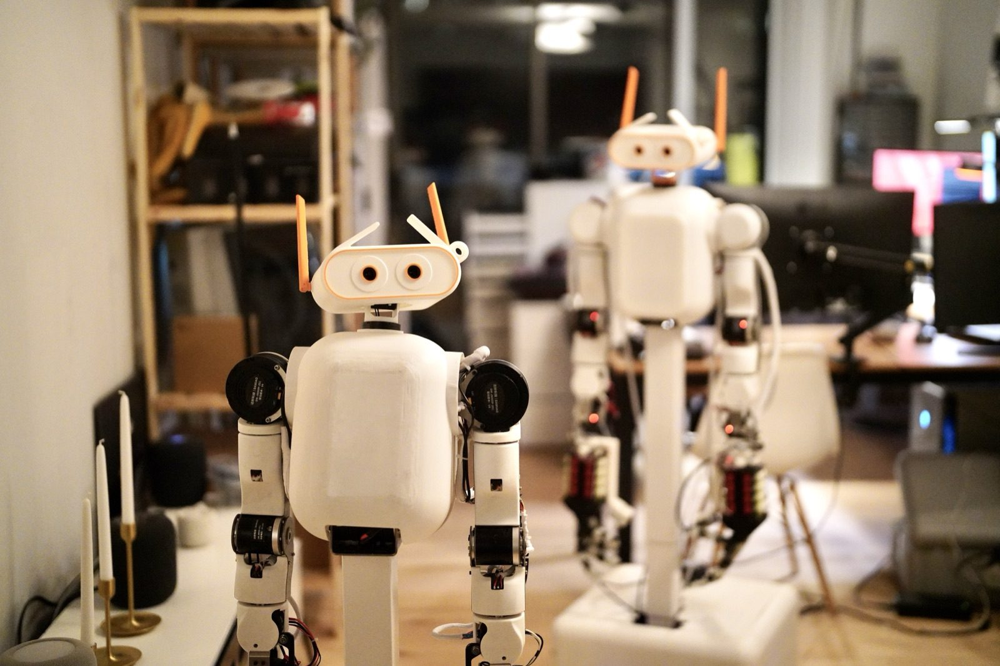
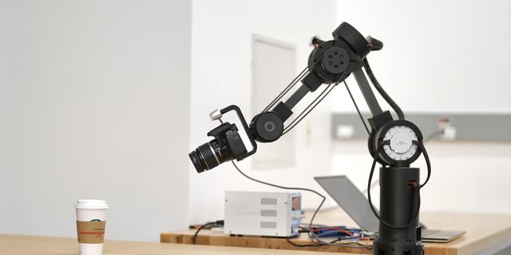
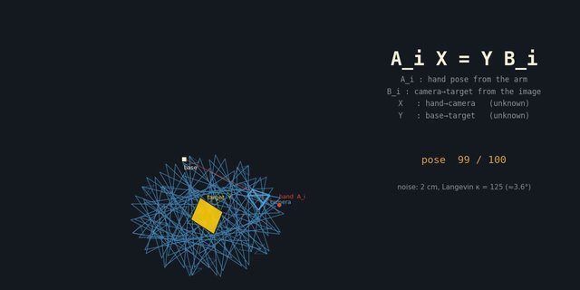
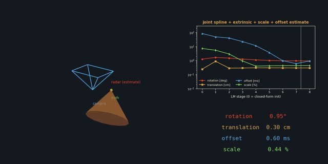
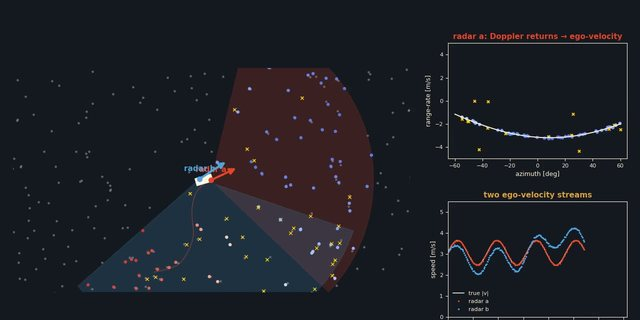
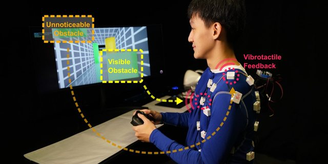
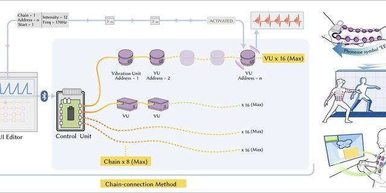

### 👋 Hey there

I want a capable personal robot in **everyone's home**, and I build the whole stack to get there: CAD, actuators, electronics, teleop, sim, and the policies on top. Lately that means **mobile bimanual robots**, **dexterous hands**, and learning with **imitation, RL and world models**.

### 🤖 Meet MABEL

<table>
<tr>
<td width="55%"></td>
<td>

**My open-source mobile bimanual robot.** MIT licensed.

🛞 Holonomic swerve base + lift 
💪 Two 7-DOF arms 
🖐️ Two 17-DOF ORCA hands 
👀 Active head, **56 DOF** in total 
💸 From **~$8.7k**, no machine shop 
🥽 Teleop from Vision Pro, iPhone, browser or gamepad 
🧪 MuJoCo twin + on-board ACT / DP / π0

System paper under review

</td>
</tr>
</table>

### ✨ Past work <i>scroll →</i>

<table>
<tr>
<td valign="top"> <b>🎥 IRIS</b> · <i>CRV 2026 Oral</i> 3D-printed cinema arm that learns object-aware camera moves</td>
<td valign="top"> <b>📐 Hand-eye calibration</b> · <i>IJRR 2025</i> Certifiably correct robot-world and hand-eye calibration</td>
<td valign="top"> <b>📡 Radar ↔ camera</b> · <i>T-RO 2022</i> Target-free spatiotemporal radar-camera calibration</td>
<td valign="top"> <b>📡 Radar ↔ radar</b> · <i>AIM 2023</i> Extrinsics from ego-velocity alone, no targets, no overlap</td>
<td valign="top"> <b>🦺 AeroHaptix</b> · <i>RA-L 2024</i> Wearable vibrotactile suit for safer drone teleoperation</td>
<td valign="top"> <b>📳 VibraForge</b> · <i>CHI 2025</i> Scalable toolkit for prototyping spatial vibrotactile feedback</td>
</tr>
</table>

📄 Also co-authored <i>Evolution of Humanoid Locomotion Control</i> (<b>Science Robotics 2026</b>) · <a href="https://thejerrycheng.github.io/publications.html">all publications →</a>

🔭 **Currently cooking:** dexterous tool use, real-to-sim-to-real learning, and collaborative mobile manipulation. More soon 👀

### 🧰 Toolbox

         

 
<i>"Those who are truly serious about software should design their own hardware."</i>: Steve Jobs 
☕ <a href="https://calendly.com/jerrychengh990427/coffee-chat-with-jerry-cheng"><b>Grab a coffee chat</b></a> · always happy to talk robots

