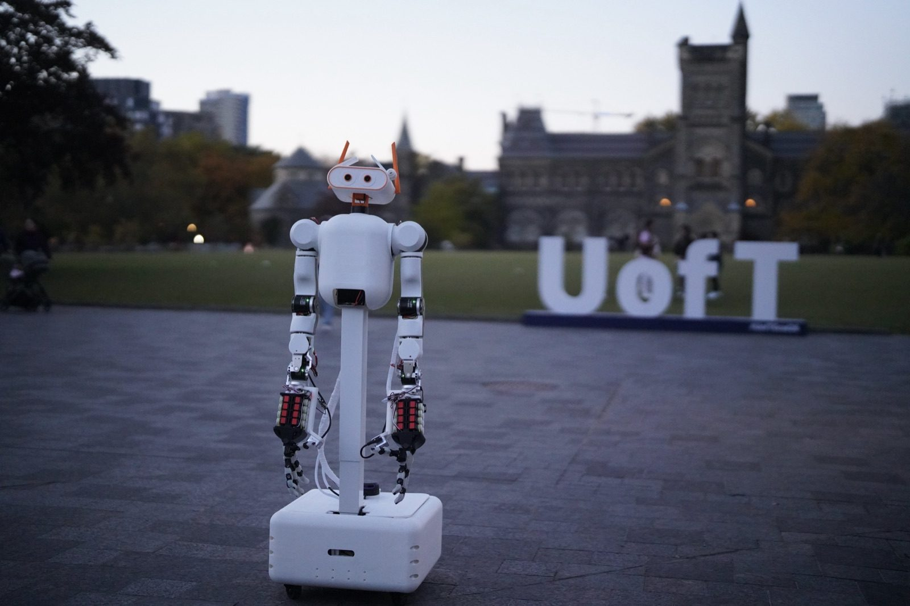
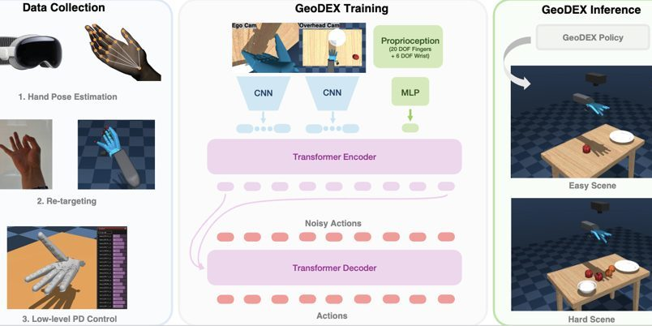

**Robotics Ph.D. candidate @ University of Toronto** · [STARS Lab](https://starslab.ca/) with Prof. Jonathan Kelly 
Previously Ph.D. @ NYU (Machines in Motion) · M.Eng. & B.A.Sc. @ UofT

---

### 👋 About

I want a capable personal robot in **everyone's home**, and I think the way to get there is to build the whole stack: CAD, actuators, electronics, teleop, sim, and the policies that run on top.

- 🦾 **Mobile bimanual robots:** whole-body platforms that roll, reach and handle real homes
- ✋ **Dexterous manipulation:** multi-fingered hands, contact-rich skills, tool use
- 🧠 **Robot learning:** imitation from human demos and video, **RL**, and **world models**
- 🛠️ **Full-stack hardware:** if it's on the robot, I've probably printed, wired or flashed it

---

### 🤖 Meet MABEL

<table>
<tr>
<td width="55%"></td>
<td>

**Open-source mobile bimanual robot.** MIT licensed.

🛞 Holonomic swerve base + lift 
💪 Two 7-DOF arms 
🖐️ Two 17-DOF ORCA hands 
👀 Active head, **56 DOF** in total 
💸 From **~$8.7k**, no machine shop required 
🥽 Teleop from Vision Pro, iPhone, browser or gamepad 
🧪 MuJoCo twin and an on-board policy stack (ACT, DP, π0)

System paper under review · <a href="https://thejerrycheng.github.io/">more on the website →</a>

</td>
</tr>
</table>

---

### ✨ Selected work

<table>
<tr>
<td width="50%" valign="top">
 
<b>🎥 IRIS</b> · <i>CRV 2026, Oral</i> 
Low-cost 3D-printed 6-DOF cinema arm that learns smooth, object-aware camera moves from demos.
</td>
<td width="50%" valign="top">
 
<b>✋ GeoDEX</b> 
Vision Pro hand demos retargeted onto a 23-DoF arm + hand, then cloned into a transformer policy.
</td>
</tr>
</table>

📄 Also: *Evolution of Humanoid Locomotion Control* (**Science Robotics 2026**) · certifiable hand-eye calibration (**IJRR 2025**) · **AeroHaptix** (RA-L 2024) · **VibraForge** (CHI 2025) · [all publications →](https://thejerrycheng.github.io/publications.html)

🔭 **Currently cooking:** dexterous tool use, real-to-sim-to-real learning, and collaborative mobile manipulation. More soon 👀

---

### 🧰 Toolbox

  
  
  
  
  
  
  
  
  
  

---

<i>"Those who are truly serious about software should design their own hardware."</i>: Steve Jobs  
☕ <a href="https://calendly.com/jerrychengh990427/coffee-chat-with-jerry-cheng"><b>Grab a coffee chat</b></a> · always happy to talk robots

